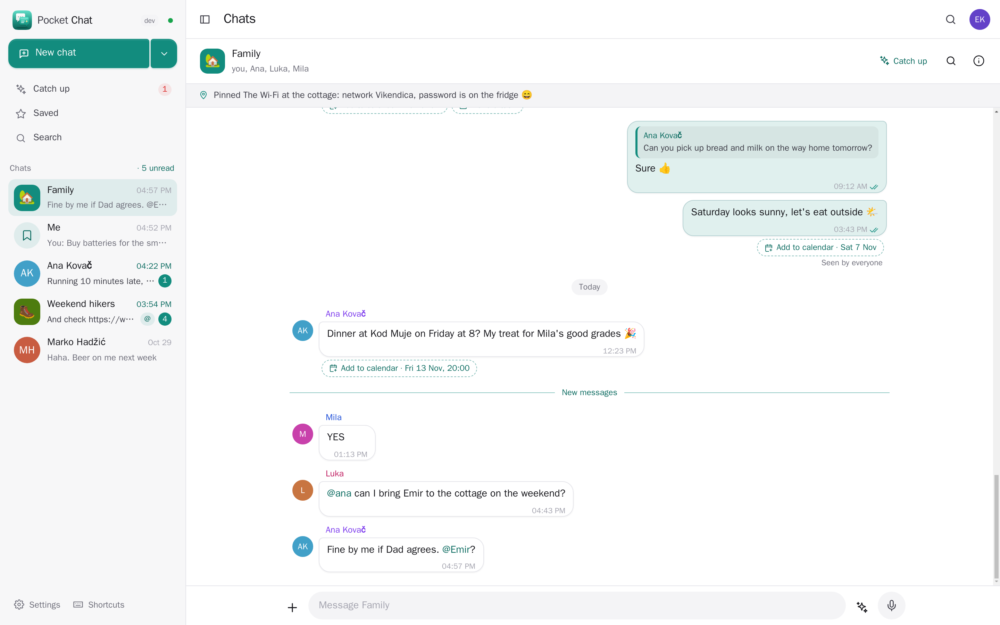
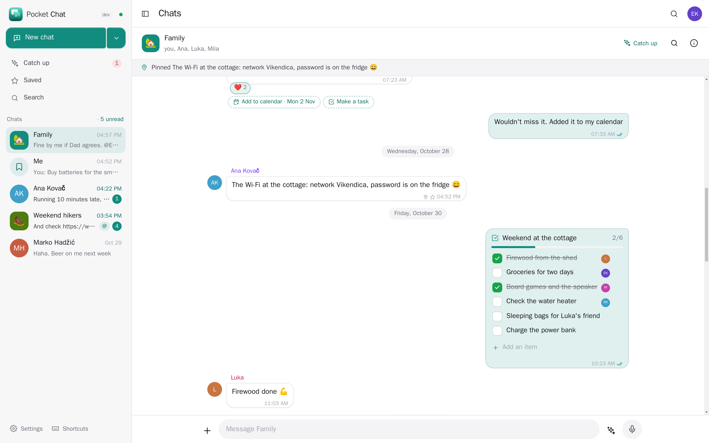
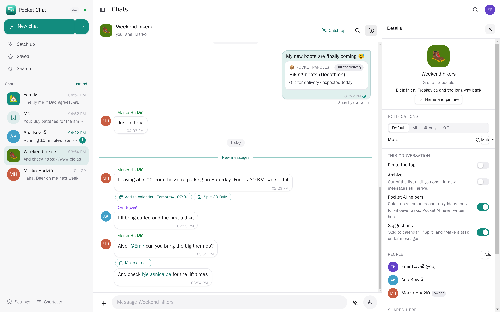
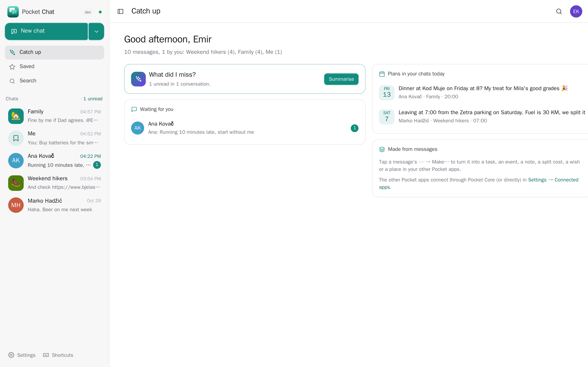
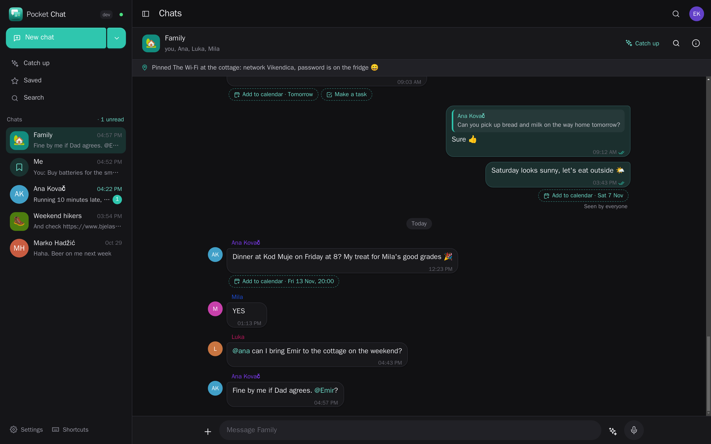
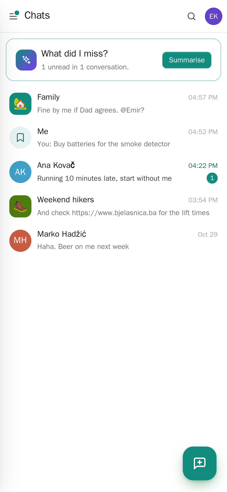
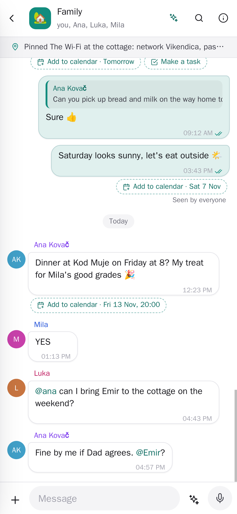
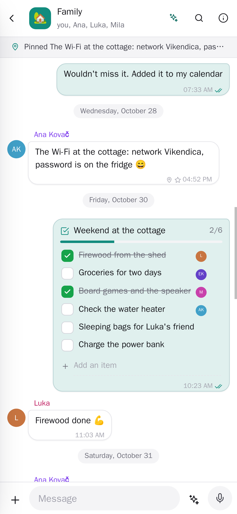
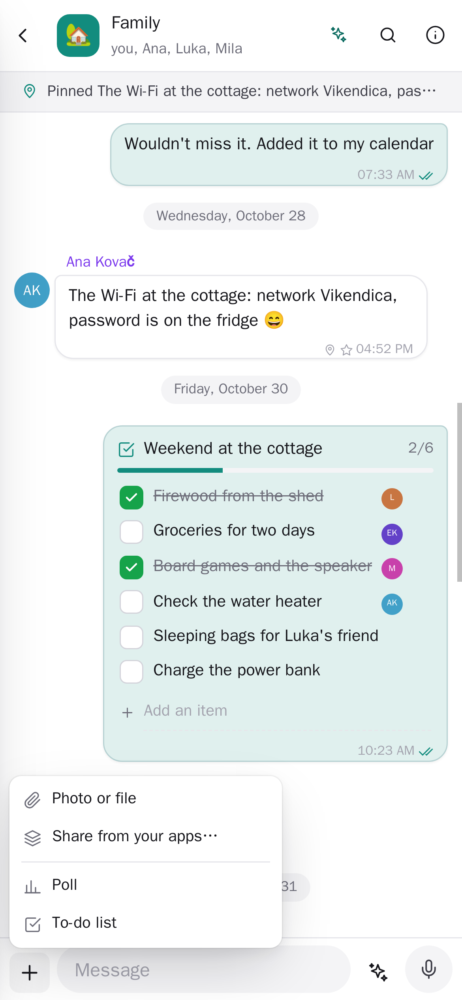

<p align="center"></p>
<h1 align="center">Pocket Chat</h1>
<p align="center">Private chat for your household and friends on your own server: one-to-one, groups and a space for yourself. Share anything from your Pocket apps as a card, turn a message into a task, an event, a note or a split cost in one tap, and catch up on what you missed with a summary only you see. One Go binary, one SQLite file, one volume. Part of the Pocket apps; works on its own too.</p>
<p align="center">
  <a href="https://github.com/abjelosevic88/pocket-homelab-chat/actions/workflows/ci.yml"></a>
  <a href="https://github.com/abjelosevic88/pocket-homelab-chat/pkgs/container/pocket-homelab-chat"></a>
  <a href="LICENSE"></a>
</p>

<p align="center"></p>

<table>
  <tr>
    <td width="50%"></td>
    <td width="50%"></td>
  </tr>
  <tr>
    <td align="center"><sub>A to-do list everyone ticks off, the Wi-Fi password pinned for everyone.</sub></td>
    <td align="center"><sub>A delivery shared from Pocket Parcels; "Split 30 BAM" and "Add to calendar" under the plan.</sub></td>
  </tr>
  <tr>
    <td width="50%"></td>
    <td width="50%"></td>
  </tr>
</table>

<p align="center">
  
  
  
  
</p>

## What it does

It replaces the family WhatsApp group with something that lives on your server and knows your other apps.

- **Chats like you expect**: one-to-one, groups with a name, emoji and colour, and **Me**, your own space for notes, links and things to file later. Replies, reactions, editing, deleting for everyone, pinning, saving, @names (@all too), read receipts, "is writing…", who is online, drafts that wait, archive, mute for an hour or a week. Everything arrives live.
- **Photos, files and voice messages**: pick, paste or drop them. Photos lose their camera data (location too). Voice messages are written out by **Pocket Voice** on this server (whisper), so everyone can read them and search finds them.
- **Polls** (one choice or several) and **shared to-do lists**: anyone can tick an item, add one or give it to someone.
- **Suggestions under messages, without any AI**: "Dinner on Saturday at 8?" gets *Add to calendar · Sat 7 Nov, 20:00*, "I paid 42 € for groceries" gets *Split 42 EUR*, "can you pick up milk?" gets *Make a task*. In English and in Bosnian, Croatian and Serbian ("sutra u 19h", "30 KM").
- **Make… from any message**: a task in **Pocket Tasks**, an event in **Pocket Calendar**, a note in **Pocket Notes**, a split cost in a **Pocket Split** group, a wish in **Pocket Wishlist**, a place in **Pocket Places**. Each keeps who said it and a link back, and the message shows you (only you) what you made of it.
- **Share from your apps** as a card everyone can read: an event, a task, a note, a place, a recipe with its ingredients, a gift idea, a trip, where a delivery is, a book, a film, today's weather. Others can save a shared event, place, wish or task to *their* own apps in one tap.
- **Pocket AI helps only you, and never writes into a conversation**: **Catch up** summarises what you missed (what is for you, the plans made) and keeps it as a note if you like; ✨ suggests replies; any message can be translated; "Fill in with AI" reads a message for a task or an event.
- **Notifications that respect you**: a push (Apprise, ntfy, Pocket Alerts) only when Chat is not open anywhere, per conversation all / only when named / off, quiet hours, a morning summary.
- **Search** every conversation, accents ignored, with filters for photos, files, links, cards, polls and voice.
- **Bring your WhatsApp chats**: export a chat (with media) and say who is who; messages and photos come in, and bringing the same file twice adds nothing twice. Export yours as JSON or as text.
- **Private by design**: a conversation is seen only by the people in it — admins manage accounts, they do not read chats. Link previews fetch public pages only, never addresses on your network.

## Run it

```sh
docker run -d --name pocket-chat -p 8080:8080 -v ./data:/data \
  -e BASE_URL=https://chat.example.com -e SECURE_COOKIES=true \
  ghcr.io/abjelosevic88/pocket-homelab-chat:latest
```

or `docker compose up -d` with [docker-compose.yml](docker-compose.yml). Open it and create the first account; add the household under Settings → People (with Pocket Core everyone who signs in once is there). Behind a reverse proxy keep the live stream unbuffered (Caddy: `flush_interval -1`). Release binaries for Linux, macOS, Windows and FreeBSD are on the releases page. See [configuration](docs/configuration.md), [API](docs/api.md), [backup](docs/backup.md), [reverse proxy](docs/reverse-proxy.md).

## With Pocket Core

Set `CORE_URL` and `CORE_REGISTRATION_KEY` and Chat joins the box: people sign in with Pocket Core, Pocket AI helps each person catch up, and each person's own app links let Chat act for them — switched on per person in Core, nothing to paste (or connect directly with a URL and a token under Settings → Connected apps):

| App | What Chat does with it | Scopes |
|---|---|---|
| Pocket Tasks | make a task from a message, share a task | `tasks:read tasks:write` |
| Pocket Calendar | add a plan to your calendar, share an event | `calendar:read calendar:write` |
| Pocket Notes | keep a message or a catch-up as a note, share a note | `notes:read notes:write` |
| Pocket Split | split a cost someone mentions in one of your groups | `groups:read expenses:write` |
| Pocket Wishlist | save a link to your wishlist, share a gift idea | `wishes:read wishes:write` |
| Pocket Places | share a place, save one a friend recommends | `places:read places:write` |
| Pocket Voice | write out voice messages on this server | `voice:transcribe` |
| Pocket Kitchen | share a recipe with its ingredients | `recipes:read` |
| Pocket Travel, Parcels, Weather, Bookshelf, Watch | share a trip, a delivery, the weather, a book, a film | `trips:read parcels:read weather:read books:read watching:read` |

Other apps can use your chats too (`chat:read`: Pocket Day writes the day's chats into your journal, Pocket Search finds messages with `!chat`, Pocket AI reads and summarises them for you; `chat:write`: an app such as Pocket Flows posts a reminder — it may change only its own messages). Pocket AI never sends a message. Chat publishes `chat.message_sent` and `chat.mentioned` on the Core bus.

## Build

```sh
make run      # demo data, no sign-in, http://localhost:8080
make test     # go vet, go test, TypeScript
make build    # web + one binary in ./pocket-chat
```

Go 1.26, SQLite (pure Go, no CGO), React 19 + Vite. MIT licensed.
